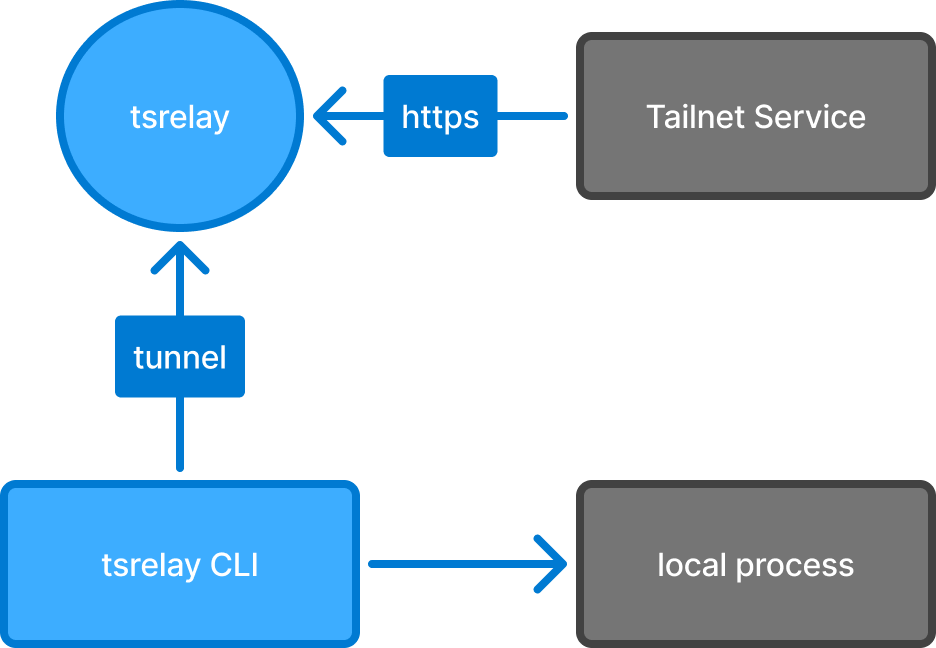

# tsrelay

Deliver HTTP callbacks from your tailnet to apps running locally, without letting production connect to developer machines, and with nothing exposed publicly unless you opt in.

Production services call the relay, which is its own tailnet node. Developer devices dial *out* to the relay and attach a tunnel. The relay forwards each callback down the tunnel to your local app and returns your app's response. Access is controlled entirely by your tailnet policy.



tsrelay is deliberately narrow. It forwards only to hooks you create explicitly. It never intercepts services as Telepresence or mirrord do, and it is reachable from the internet only for hooks their owners explicitly make public, through Tailscale Funnel, when the operator runs it with `--funnel`.

tsrelay is an independent project, not affiliated with or endorsed by Tailscale Inc. Tailscale is a trademark of Tailscale Inc.

## Why

Calls from a local device to a tailnet service are easy: you grant a user group permission to connect to a tag, and it works.
The reverse is harder. You can write the reverse grant and let a tag connect to all devices of a user, or of a whole group, but that gives every service with that tag a standing route into those devices, on every port the grant allows. Tailscale's flow logs record that two devices connected, but not which callback it was, whom it was for, or how it was answered.
It also encodes details about your developers' devices into your policy, which is annoying to maintain and keep track of.
To avoid all of this, you could reach for a tool like [ngrok](https://ngrok.com/) or [Cloudflare Tunnel](https://developers.cloudflare.com/tunnel/), but that sends internal traffic across the internet.

Instead, you can set up tsrelay: it adds a small relay service to your tailnet that you configure with standard grants and [app capabilities](https://tailscale.com/docs/features/access-control/grants/grants-app-capabilities) to control who can send and receive callbacks in your tailnet.
Users create hooks with their own delivery settings. A hook is served by one tunnel at a time; by default, a tunnel that attaches takes the hook over from the one before. While no tunnel is attached, calls wait for one up to the hook's hold timeout; a call already in flight when a tunnel drops fails, and tsrelay never retries it. Your app learns who called from headers naming the sender's node, tags or user. The relay keeps a log of recent calls, and writes an audit log, OpenTelemetry traces and Prometheus metrics.

A web interface lets users manage their hooks and view their recent calls, send test requests, and replay calls that had no body or whose body was captured in full (capture is off by default). Everything updates live.

Read the [security model](docs/security-model.md) before you run a relay: it says what the relay guarantees and what it doesn't.

## Quick start

If someone on your tailnet already runs a relay, install the CLI from it and forward a hook to your local app:

```bash
curl -fsSL https://tsrelay.<your tailnet>/install.sh | sh
tsrelay http 8080
```

To run a relay yourself, [download tsrelay](https://tsrelay.mazetti.me/download), grant access in your tailnet policy, and start it with an OAuth client secret that may create auth keys for `tag:tsrelay`:

```bash
TS_CLIENT_SECRET='tskey-client-…?ephemeral=false&preauthorized=true' tsrelay serve
```

Without the `?ephemeral=false&preauthorized=true` suffix, the relay joins your tailnet as an ephemeral device, which the tailnet removes once it has been offline for a while. [Running a relay](docs/running-a-relay.md) has the details.

## Documentation

Full documentation is at <https://tsrelay.mazetti.me>, and in [`docs/`](docs) in this repository:

- Using tsrelay: [getting started](docs/getting-started.md), [hooks](docs/hooks.md), [background tunnels](docs/background-tunnels.md), [receiving calls](docs/receiving-calls.md), [web UI and inspector](docs/web-ui.md), [API](docs/api.md) and the [command line](docs/cli.md).
- Running a relay: [running a relay](docs/running-a-relay.md), [access control](docs/access-control.md), [observability](docs/observability.md) and the [security model](docs/security-model.md).
- Reference: [configuration](docs/configuration.md), [errors](docs/errors.md) and [compatibility](docs/compatibility.md).

Binaries for macOS, Linux and Windows, and the container image, are on the [download page](https://tsrelay.mazetti.me/download).

## Contributing

Building, testing and releasing tsrelay is described in [CONTRIBUTING.md](CONTRIBUTING.md), and its design in [docs/DESIGN.md](docs/DESIGN.md). The website is in [`website/`](website) and builds its pages from [`docs/`](docs).

## License

Apache License 2.0; see [LICENSE](LICENSE) and [NOTICE](NOTICE).
