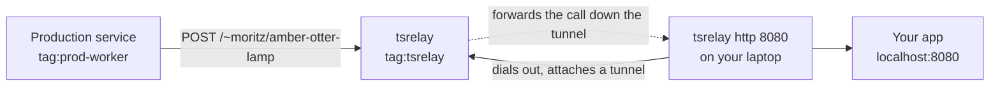

# tsrelay

Production services call the relay, which is its own tailnet node. Developer devices dial *out* to the relay and attach a tunnel. The relay forwards each callback down the tunnel to your local app and returns your app's response. Access is controlled entirely by your tailnet policy.

tsrelay is deliberately narrow. It forwards only to hooks you create explicitly. It never intercepts services as Telepresence or mirrord do, and it is reachable from the internet only for hooks their owners explicitly make public, through Tailscale Funnel, when the operator runs it with `--funnel`.

## Why tsrelay

Communication from a local device and a tailnet service is easy: You grant a user group permission to connect to a tag, and it works.
The reverse, however, is more complicated: While you can obviously just create the reverse policy and allow a tag to connect to all devices of a user, or a whole user group, that opens up a lot of security issues, is not auditable, and grants any service in prod a permanent backdoor into your endpoints.
It also encodes details about your local developer's environments into your ACL policy, which is annoying to maintain and keep track of.
To avoid all of this, you could reach for a tool like [ngrok](https://ngrok.com/) or [Cloudflare Tunnel](https://developers.cloudflare.com/tunnel/), but that tunnels internal traffic via the internet.

Instead, you can also set up tsrelay: It adds a tiny relay service to your tailnet that can be configured using standard ACLs and [app capabilities](https://tailscale.com/docs/features/access-control/grants/grants-app-capabilities) to control who can send and receive callbacks in your tailnet.
Users can set up hooks that are fully configurable, can be routed to multiple user devices, buffer requests on unreliable lines, have a full request log, include Tailscale authorization headers, and more. In turn, the relay service itself has a full audit log, OpenTelemetry traces and metrics, as well as global control over all hooks.

A web interface lets users manage their hooks and view the request log, which also offers manual calls, replays, and access to all details. Everything is updated in realtime.

## Where to start

- If someone on your tailnet already runs a relay, start with [Getting started](getting-started.md).
- To add a relay to your tailnet, start with [Running a relay](running-a-relay.md).
